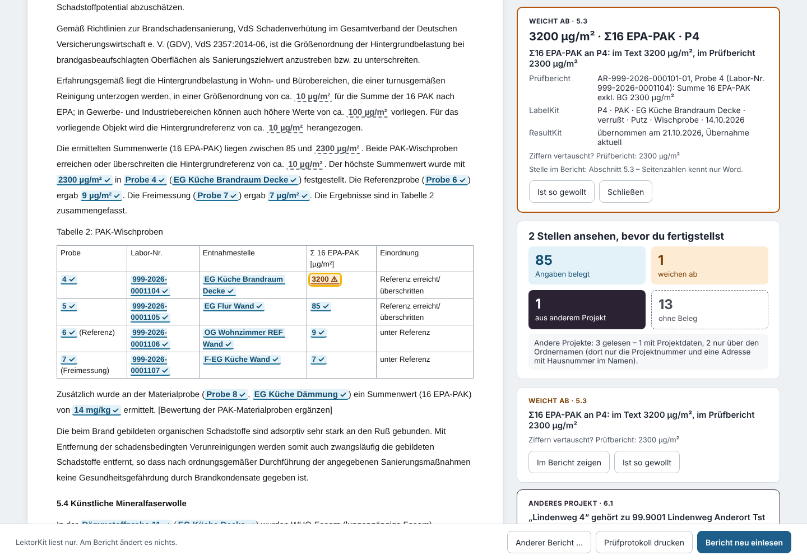

# LektorKit

Der Gegenleser der Spektron-Suite: liest einen Brandbericht (Word) und hält jede Angabe gegen die Projektdaten – bevor der Bericht ans Büro geht.



Aktuelle Version: **1.0.0** (steht oben neben dem Namen). Plan und Entscheidungen: Project-Doc `claude/gegenleser-plan.md` (Arbeitstitel „Gegenleser“).

## Benutzen

- **Aus der Projektzentrale** (Knopf folgt): `…/lektorkit/#projekt=<Ordnername>&datei=Mitteilungen/<Datei>.docx` öffnet das Projekt aus dem Archivordner (IndexedDB `mosaik-suite`, Store `kv`, Schlüssel `archiv` – wie GlasKit, PlanKit, FotoKit) und liest den Bericht sofort. Ohne `datei` wählst du den Bericht aus „Mitteilungen“.
- **Ohne Projektzentrale:** `index.html` in Edge oder Chrome öffnen (oder über GitHub Pages) → „Projektordner öffnen …“. Liegt der Ordner im Archiv der Suite, nimmt LektorKit das Archiv für die Suche nach anderen Projekten mit; sonst steht oben „Andere Projekte nicht geprüft“.
- **Von Hand geschriebener Bericht:** im Startfeld hineinziehen oder „Word-Datei wählen …“. Die Datei wird nur gelesen, nirgends gespeichert; geprüft wird gegen das geöffnete Projekt.

Links der Bericht mit jeder markierten Angabe, rechts die Übersicht und die Befunde. Klick auf eine Angabe zeigt den Beleg (Prüfbericht mit Probe und Labor-Nr., LabelKit-Zeile, Stand der ResultKit-Übernahme). „Prüfbericht öffnen“ öffnet die PDF aus „Laborergebnisse“. „Prüfprotokoll drucken“ gibt eine Seite für die Papierakte.

## Die vier Marken

| Marke | Bedeutung |
|---|---|
| belegt (hellblau, Haken) | Zahl, Einheit, Parameter und Probe stimmen mit der Quelle; Raumname wie in LabelKit; Prüfbericht gilt; Datum/Schaden-Nr./Adresse wie in den Projektdaten |
| weicht ab (orange, Warndreieck) | Quelle sagt etwas anderes: anderer Wert, anderer Raumname, Probe gibt es nicht, überholte Prüfberichtsfassung (-01, während -02 im Ordner liegt), Anlage passt nicht zur Anlagenliste |
| anderes Projekt (dunkel, Kreuz) | Projektnummer, Schaden-Nr., Straße mit Hausnummer oder Auftraggeber-/VN-/Versicherername eines anderen Projekts im Archiv, die in diesem Projekt nirgends vorkommt |
| ohne Beleg (weiß, gestrichelt) | eigene Angabe („ca. 85 m²“), Bezugsgrößen („5 bis 10 µg/cm²“), Datum des Berichts – oder eine Zahl, die sich nicht sicher genau einer Probe zuordnen lässt. **Nie ein Fehler, zählt nie als Problem.** |

Die Marken unterscheiden sich durch Zeichen und Helligkeit, nicht nur durch die Farbe. „Ist so gewollt“ (bei „weicht ab“ und „anderes Projekt“) vermerkt die Stelle mit Kürzel und Datum; sie wird grau und zählt nicht mehr als offen. „Zurücknehmen“ hebt das auf.

## Regeln (nichts Neues erfunden)

- **Welcher Wert gilt:** Prüfberichte (Eurofins-XML in „Laborergebnisse“, eine Ebene tief) nach der Regel von ResultKit 2.2/2.5 in der Kopie des Datenarchivs (`archiv/auswertung.js` `projektAuswerten`: Fassung -01/-02, endgültig vor vorläufig, zwei Grundnummern für dieselbe Probe = Konflikt, fremde Auftragsreferenz zählt nicht). Ist `_Ergebnisse.json` aktuell (Dateistand wie ResultKit), zählen auch ihre Werte (`mitErgebnisDatei`). **Strenger als das Datenarchiv:** Werte aus einer nicht aktuellen Übernahme zählen nie, auch nicht aus einer PDF, die noch daliegt – die Angabe ist dann „nicht prüfbar“.
- **Gleich:** Zahl streng gelesen wie im Datenarchiv (`zahl`, `ergebnis`: „< BG“, „n. n.“, Dezimalkomma; „1.200“ ist mehrdeutig → nur gleich, wenn gleich geschrieben). Einheit nur in der Schreibweise angeglichen. Umgerechnet wird nur Chlorid (1 µg/cm² = 10 mg/m², ResultKit KORROSION-CHLORID v2) und Σ16 EPA-PAK (Tabelle aus ResultKit `vdsScale`). **Keine Rundung:** „12 µg/cm²“ bei 12,3 ist „weicht ab“, der Befund sagt „gerundet? Prüfbericht: 12,3“, damit „Ist so gewollt“ schnell geht. Passen nur die Ziffern vertauscht, steht „Ziffern vertauscht?“ dabei.
- **Hauptwert:** Chlorid (`/^\s*Chlorid\b/`) und Σ16 EPA-PAK (`/^(?:Summe|Σ)\s*16\s*EPA[-– ]?PAK/`) wie ResultKit `uebersicht.ts`; bei mehreren Einheiten zuerst die Einheit aus dem Text, sonst der Wert je Fläche (`FLAECHE`).
- **Zuordnung zu einer Probe:** Wert direkt vor „(Probe n“ oder „in Probe n“ → diese Probe; sonst genau eine Probe im Satz → diese; mehrere Proben im Satz → **ohne Beleg**. Tabellen mit Spalte „Probe“ und einer Wertspalte „Chlorid [Einheit]“/„Σ 16 EPA-PAK [Einheit]“ zeilenweise. Ist der Parameter nicht eindeutig (Chlorid oder PAK?), ohne Beleg. In Abschnitten über Brandgeruch meint „Probe n“ die n-te Brandgeruch-Probe (wie BerichtKit).
- **Proben und Raumnamen:** LabelKit-Datei dieses Projekts (`labelkitWahl`), Nummer wie ResultKit (`_nr`, `chloridNr`, `id`; PAK → Chlorid → Asbest → Sonstige fortlaufend). Raumname gleich nach ResultKits `beschreibungKey` – mit LabelKits „Raum/Ort“ oder mit BerichtKits ausgeschriebenen Kürzeln (`raumAusschreiben`: WZ → Wohnzimmer …).
- **Anderes Projekt:** alle Projektordner im Archiv; `_Projekt.json` (erst `_Spektron/`, dann der frühere Ort) – fehlt sie, nur der Ordnername (Projektnummer, Adresse nur mit Hausnummer im Namen). Die Übersicht sagt, wie viele Projekte mit Projektdaten und wie viele nur über den Ordnernamen gelesen wurden. Nie: ein Ort allein, die Büroadresse (Gouleystr. 59), „Schiffers“, „Eurofins“, „Würselen“, Namen unter 10 Zeichen, irgendetwas, das auch in den Daten dieses Projekts steht (Projektdaten, Ordnername, LabelKit-Datei, Auftragsreferenzen).
- **Datum:** In BerichtKits festen Sätzen („Schaden vom:“, „Am … kam es“, „Am … fand eine Besichtigung“, „Am … wurde unser Büro beauftragt“, „am … sensorisch auf Brandgeruch geprüft“) gegen das passende Feld → belegt oder weicht ab. Sonst belegt, wenn das Datum in einer Projektdatei steht, sonst ohne Beleg.
- **Nicht prüfbar:** Zahlen ohne geltenden Laborwert (nur PDF, Übernahme nicht aktuell, Konflikt, noch kein Wert) stehen mit Zahl und Grund in **einer gelben Zeile oben**; die Überschrift sagt dann nie „Keine Abweichung gefunden“ allein.

## Was LektorKit schreibt

Nur die eigene Datei, und nur bei „Ist so gewollt“/„Zurücknehmen“:

- Spektron-Projekt (ab 26.0560 oder mit `_Spektron`): `_Spektron/LektorKit/_LektorKit.json`
- Projekt vor Spektron: `Mitteilungen/_LektorKit.json` – **nie** einen `_Spektron`-Ordner anlegen (das würde das Projekt für alle Apps umschalten)

```json
{ "format": "spektron-lektorkit", "version": 1, "gewollt": [ { "schluessel": "wert|5.2|P1|12 µg/cm²|Chlorid", "text": "12 µg/cm²", "befund": "…", "datei": "1._Mitteilung_26.0600_Entwurf.docx", "kuerzel": "Dr.Ka", "am": "2026-11-13" } ] }
```

Der Schlüssel enthält den Dateinamen nicht – eine Bestätigung gilt weiter, wenn aus `…_Entwurf.docx` die fertige Mitteilung wird. Vor dem Schreiben frisch gelesen (Bestätigungen von Kollegen bleiben), nach dem Schreiben zurückgelesen. Eine Datei in unbekanntem Format wird nie überschrieben. Kürzel: `localStorage` `lektorkit-kuerzel`, sonst „Ich bin“ der Projektzentrale (`spektron-ich`), sonst Auswahl aus `_Spektron-Mitarbeiter.json`.

## Aufbau

Eine Datei `index.html`, offline, ohne Abhängigkeiten. Bearbeitet wird in `src/`; `node tools/einbetten.cjs ../projektzentrale` baut `index.html`:

| Block | Herkunft |
|---|---|
| `spektron-ordner` | Projektzentrale `spektron-ordner.js`, byte-gleich |
| `archiv-auswertung` | Projektzentrale `archiv/auswertung.js`, byte-gleich |
| `word-luecken` | Projektzentrale `word-luecken.js`, byte-gleich (nur `textteile`: .docx entpacken) |
| `lektor-regeln` | `xmlLesen` wörtlich aus `archiv/lesen.js`; kleine Kopien aus ResultKit und BerichtKit, je mit Gegenprobe |
| `lektor-kern` | `src/lektor-kern.js`: Word lesen, Angaben finden, vergleichen |
| `lektor-app` | `src/lektor-app.js`: Ordner, Oberfläche, eigene Datei, Prüfprotokoll |

## Prüfen

```sh
NODE_PATH=<node_modules mit playwright> node tests/lektorkit-check.cjs alle      # a–k, Chromium headless, ca. 1 min
node tests/lektorkit-check.cjs vorschau                                          # docs/vorschau.png neu
node tests/vorlage-berichtkit.cjs ../berichtkit                                  # Vorlage neu erzeugen (erzeugt, nicht von Hand ändern)
```

Prüfung a braucht `../projektzentrale`, `../resultkit`, `../berichtkit` daneben. Nur erfundene Daten: der Brandbericht `tests/fixtures/berichtkit-br1.docx` ist BerichtKits eigener Bericht aus seinen erfundenen Testdaten „BR1“. In der Sandbox Chromium mit `LANG=C.UTF-8` starten (sonst landen Ordner mit Umlauten im privaten Dateisystem falsch) – das Testskript setzt es selbst.

## Grenzen (1.0)

- Nur Brandbericht; Asbest-Ergebnisse, KI-Werte und Brandgeruch-Bewertungen werden nicht verglichen (nur Probe und Raumname).
- Seitenzahlen kennt nur Word – angegeben wird der Abschnitt. Seiten im Prüfbericht werden nicht gelesen (keine PDF-Bibliothek).
- Mengenangaben („drei Wischproben“) und Spannen („zwischen 4,1 und 12,3“) werden nicht geprüft (ohne Beleg).
- Straßen nur in der Form „Name + Straße/Weg/Platz … + Hausnummer“; „Am Markt 3“ u. ä. werden nicht erkannt.
- Nur an erfundenen Daten geprüft – siehe Project-Doc `claude/lektorkit-stand.md`, „NICHT geprüft“.
